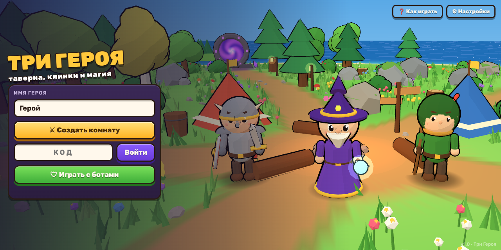
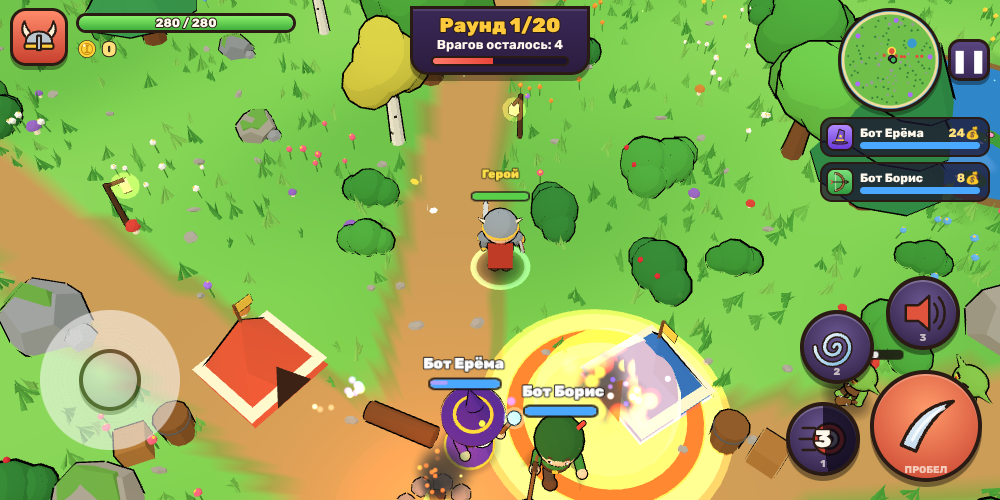
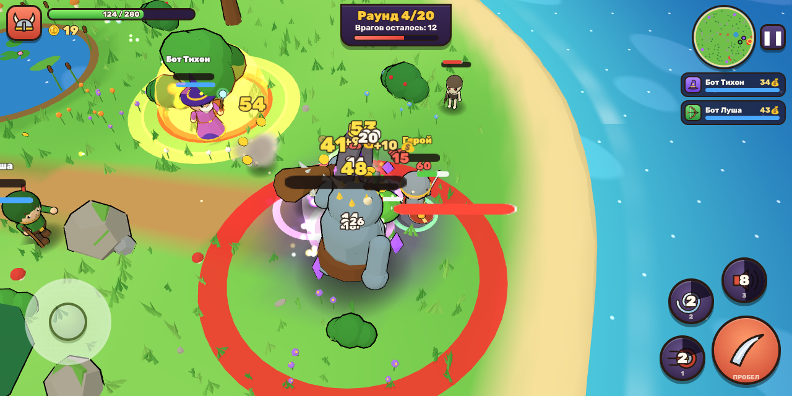
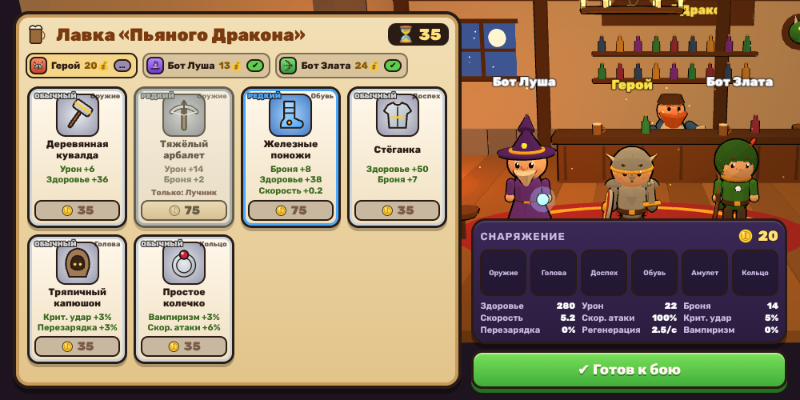
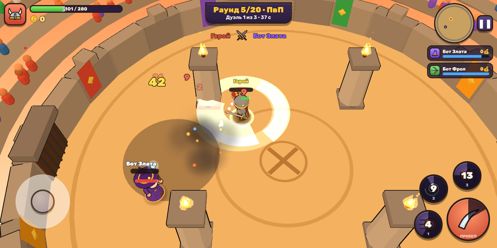

# 🐉 25 waves

Кооперативная 2.5D игра для 3 игроков в мультяшном стиле для **iOS**, **Android** и браузера.

Трое игроков выбирают из семи героев — **воин**, **маг**, **лучник**, **охотник на демонов**, **призыватель**, **оборотень** и **гном** — и защищают остров от волн чудовищ. С каждым раундом мобов становится больше. Золото с моба получает тот, кто его добил. Между раундами герои отдыхают в таверне и покупают снаряжение из **общего** ассортимента: купленная вещь исчезает у всех. Каждый 5-й раунд — **ПвП**: дуэли каждого с каждым, победа приносит золото, поражение его отнимает.



| Бой | Босс |
|---|---|
|  |  |
| **Таверна** | **ПвП-арена** |
|  |  |

## Возможности

- **Три класса** со своими характеристиками, пассивкой и 4 умениями:
  - **Воин** (стойкость): удар мечом, рывок щитом с оглушением, вихрь, боевой клич (баф союзников, на себя агрит врагов).
  - **Маг** (восстанавливающийся магический щит): чародейская стрела, огненный шар с горящей землёй, ледяная волна (заморозка), метеор.
  - **Лучник** (+20% крита, быстрее бегает): выстрел, залп из 5 стрел, кувырок с неуязвимостью, дождь стрел.
  - **Охотник на демонов** (парные клинки, вампиризм 6%): двойной удар, теневой рывок с неуязвимостью, глефа, отскакивающая между 4 врагами, демоническая форма (+40% скорости атаки, крылья).
  - **Призыватель** (25% урона по нему забирает ближайший помощник): духовная стрела, два духа-волка (замедляют), каменный голем (отвлекает врагов, бьёт по площади), тотем духов (стреляет, каждые полсекунды ранит всех врагов в круге и лечит союзников). Помощники сражаются с мобами сами.
  - **Оборотень** (когти, кастеты или серпы; ниже 40% здоровья бьёт сильнее и быстрее лечится): удар когтями, прыжок с ударом при приземлении, вой (страх и замедление вокруг), звериная форма (растёт, бьёт сильнее и быстрее).
  - **Гном** (мушкетон, ручная пушка или рунное ружьё; получает на 12% меньше урона): залп дробью веером, пороховая бочка, механическая турель, землетрясение.
- **6 слотов снаряжения**: оружие (своё для каждого класса), голова, доспех, обувь, амулет, кольцо. 5 редкостей — обычная, редкая, эпическая, легендарная и алая **реликвия** (с 10-го раунда). Две силы урона: **сила атаки** — урон обычной атаки, **сила умений** — урон умений, зон, рывков и помощников. Силу умений даёт каждый предмет (больше у редких и в поздних раундах), сила атаки — в основном оружие, амулеты и кольца. Экипировка видна на модели героя: цвета доспехов, наплечники, корона, крылатые сапоги, светящееся оружие, аура.
- **Открытый остров**: лес, пруд с кувшинками, древние руины, лагерь с костром, 5 порталов, из которых лезут мобы. Мир генерируется из сида одинаково у всех игроков.
- **Мобы**: слизни, гоблины, скелеты-лучники, орки и **тролль-вождь** (босс каждые 4, 9, 14… раунды: бьёт по площади вокруг себя и метает боевой молот, который возвращается к нему, как бумеранг).
- **Таверна «Пьяный Дракон»**: общий магазин на всех, таймер, готовность, сравнение характеристик, возврат 40% цены за старую вещь.
- **ПвП-арена** с трибунами и ликующей толпой. Дуэли каждого с каждым.
- 20 раундов, итоговая таблица (убийства, урон, ПвП, золото).
- **Сеть**: авторитетный сервер, 20 тиков/с, интерполяция и предсказание движения, переподключение после обрыва связи (и после перезагрузки страницы).
- **Боты**: можно заполнить пустые места ботами или играть одному (одиночная игра идёт прямо на телефоне без сервера). Хозяин добавляет бота кнопкой в пустом месте и выбирает ему класс, нажав на его иконку.
- **Управление**: плавающий джойстик + кнопки умений. Касание умения — автоприцел, перетаскивание — ручное прицеливание (с индикатором), перетащить на ✕ — отмена. На компьютере: WASD, пробел/клик, 1-2-3.
- Мультяшная графика: cel-shading, контуры, процедурные анимации, частицы, тряска камеры, кроны деревьев просвечивают перед героем. Процедурные звуки и музыка (WebAudio), вибрация.

Все модели, иконки, звуки и музыка созданы кодом — внешних ассетов нет.

## Структура

```
shared/   общая логика: данные классов/предметов/мобов, симуляция Game, боты, протокол, тесты
server/   Node.js + WebSocket: комнаты с 4-значными кодами, игровой цикл, раздача веб-клиента
client/   Three.js + Vite: рендер, интерфейс, управление, звук; Capacitor-проекты android/ и ios/
```

## Быстрый старт (разработка)

Нужен Node.js 20+.

```bash
npm install
npm run server      # игровой сервер на порту 2567
npm run dev         # клиент на http://localhost:5173
```

Откройте http://localhost:5173 в трёх вкладках (или с телефонов в той же Wi‑Fi сети: `http://<IP компьютера>:5173`). Один игрок создаёт комнату, остальные вводят её код.

Тесты и проверка типов:

```bash
npm test
npm run typecheck
```

Подсказка для проверки: в одиночной игре можно начать с любого раунда — `http://localhost:5173/?round=5` (ПвП) или `?round=4` (босс).

## Играть втроём по сети (сервер в интернете)

Нажмите кнопку, войдите в Render через GitHub и подтвердите создание сервиса (бесплатный тариф):

[](https://render.com/deploy?repo=https://github.com/XDCIBX/For-3)

Через несколько минут Render выдаст адрес вида `https://three-heroes-xxxx.onrender.com`. Эту ссылку открывают все трое (на телефоне — в горизонтальном положении): один нажимает «Создать комнату», остальные вводят код. Бесплатный сервер засыпает после 15 минут без игроков; первое открытие после этого занимает около минуты.

## Запуск сервера для игры

```bash
npm run build       # собирает клиент и сервер
npm start           # http://0.0.0.0:2567 — сервер + веб-версия игры
```

Или в Docker:

```bash
docker build -t three-heroes .
docker run -p 2567:2567 three-heroes
```

Сервер раздаёт и веб-клиент, поэтому можно играть прямо из браузера телефона по адресу `http://<сервер>:2567`. В мобильном приложении адрес сервера указывается в **Настройках** (например `ws://192.168.0.10:2567`, а для сервера в интернете за HTTPS — `wss://example.com`).

## Сборка мобильных приложений

Используется [Capacitor](https://capacitorjs.com). Нативные проекты уже лежат в `client/android` и `client/ios` (ориентация — только горизонтальная, полноэкранный режим, экран не гаснет, разрешён доступ к серверу в локальной сети).

### Android

Нужны Android Studio (или Android SDK) и JDK 21.

```bash
cd client
npm run android     # сборка + cap sync + открыть Android Studio
# или из консоли:
npm run build && npx cap sync android && cd android && ./gradlew assembleDebug
```

APK появится в `client/android/app/build/outputs/apk/debug/`. GitHub Actions (`.github/workflows/build.yml`) собирает debug APK автоматически при каждом пуше — его можно скачать из артефактов сборки.

### iOS

Нужен Mac с Xcode 16+.

```bash
cd client
npm run ios         # сборка + cap sync + открыть Xcode
```

В Xcode выберите свою команду разработчика (Signing & Capabilities) и запустите на устройстве.

### Иконки и заставка

Исходники — в `client/assets` (рендерятся из моделей игры страницей `client/dev/icon.html`). Пересоздать все размеры: `npx @capacitor/assets generate --android --ios`.

## Баланс и правила

- Раунд N: около `5 + 3.5·N` мобов (меньше, если игроков меньше), здоровье и урон мобов растут с каждым раундом.
- Золото за убийство — только убийце; всем выжившим и павшим — бонус за раунд `15 + 5·N`.
- Павший герой возрождается через несколько секунд. Если пали все одновременно — поражение.
- ПвП (раунды 5, 10, 15, 20): победа `+40 + 10·N`, поражение `−(20 + 5·N)` золота. По истечении времени побеждает тот, у кого больше доля здоровья.
- Таверна: 45 секунд или пока все не нажмут «Готов». Ассортимент — по оружию для каждого класса в игре и случайные вещи; шанс редких предметов растёт с раундом.

Основные числа — в `shared/src/data/*.ts` и `shared/src/constants.ts`.
