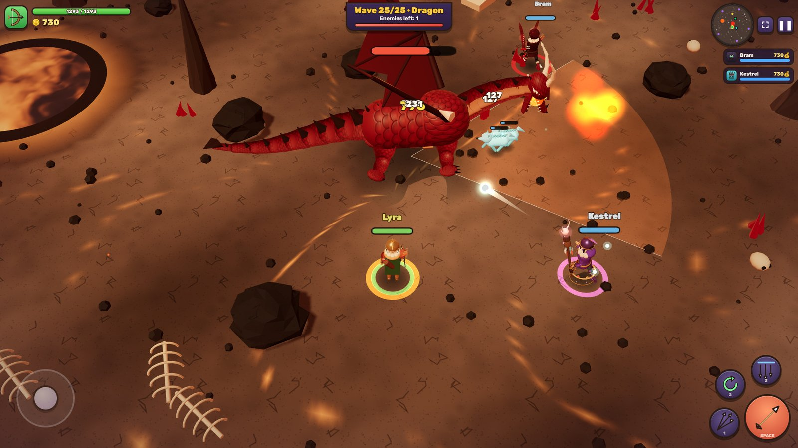
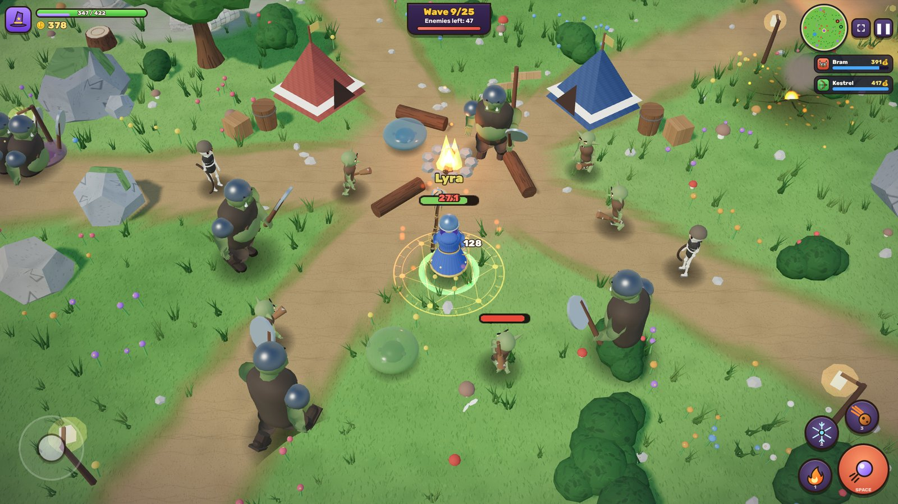
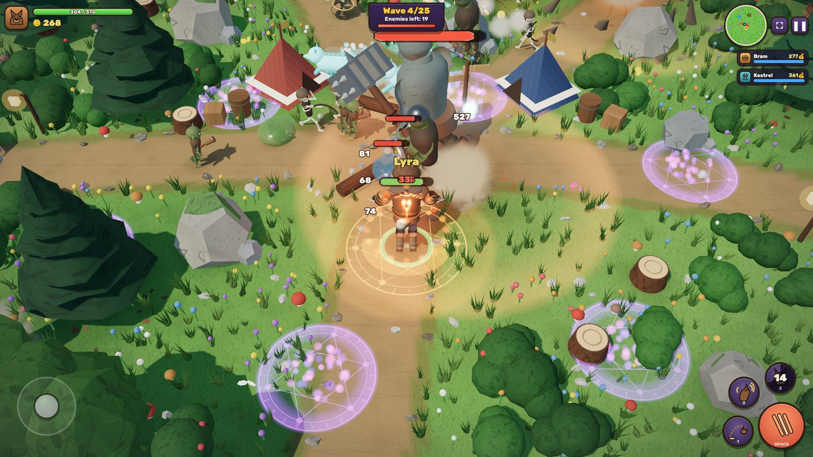
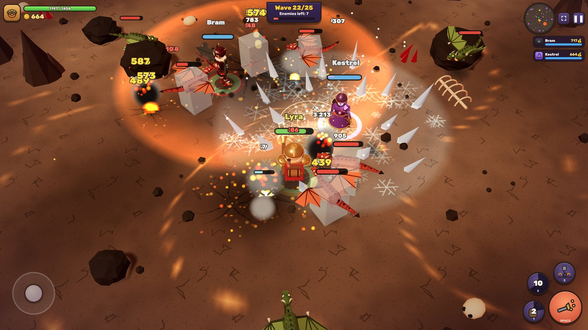
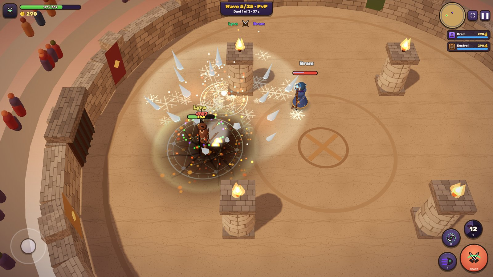
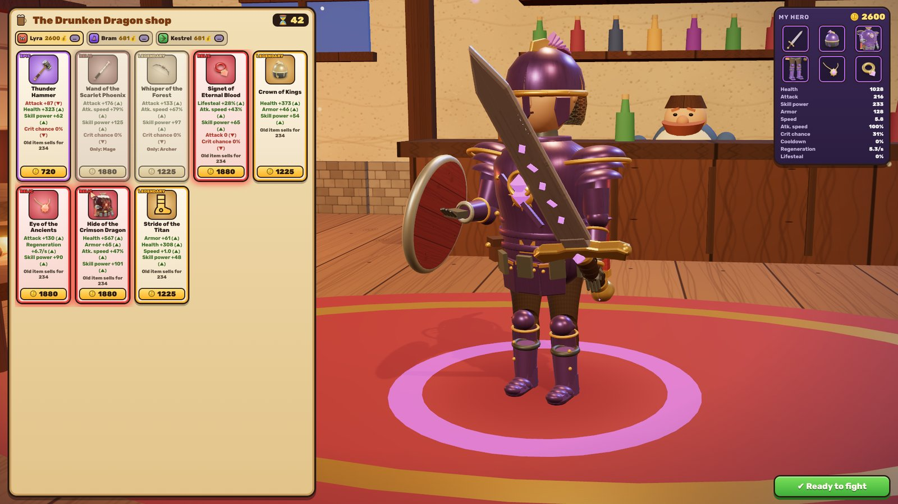
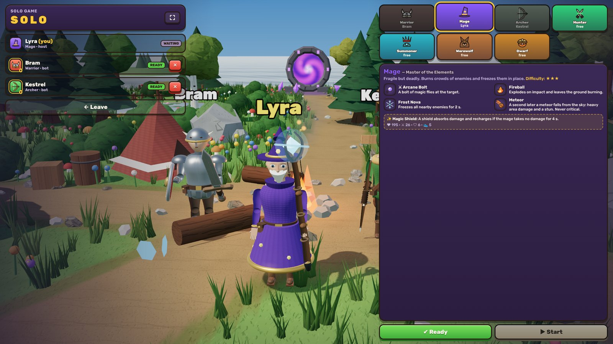
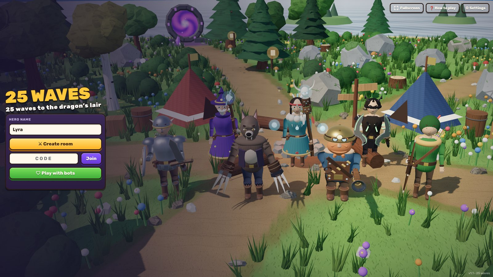

# 🐉 25 Waves

Кооперативный 2.5D-экшен на троих: **25 волн** чудовищ, общая лавка в таверне, ПвП-дуэли между союзниками
и финальная битва с **красным драконом**. Играется в браузере, на **iOS** и **Android**, на ПК — **Windows,
macOS, Linux и Steam Deck** (версия для Steam со Steamworks).

Трое игроков выбирают из семи героев и защищают остров от орд. Золото за моба получает тот, кто его добил.
Между волнами герои отдыхают в таверне и покупают снаряжение из **общего** ассортимента: купленная вещь
исчезает у всех. Каждая пятая волна — дуэли каждого с каждым. С 21-й волны бой переносится в логово
дракона, а на 25-й выходит он сам.



| Остров | Тролль-вождь |
|---|---|
|  |  |
| **Логово дракона** | **ПвП-дуэль** |
|  |  |
| **Таверна** | **Лобби и выбор героя** |
|  |  |



## Возможности

- **Семь героев**, у каждого своя пассивка и 4 умения:
  - **Воин** (стойкость): удар мечом, рывок щитом с оглушением, вихрь, боевой клич (усиливает союзников, на себя агрит врагов).
  - **Маг** (восстанавливающийся магический щит): чародейская стрела, огненный шар с горящей землёй, ледяная волна (заморозка), метеор.
  - **Лучник** (+20 % крита, быстрее бегает): выстрел, залп из 5 стрел, кувырок с неуязвимостью, дождь стрел.
  - **Охотник на демонов** (парные клинки, вампиризм): двойной удар, теневой рывок, глефа, отскакивающая между врагами, демоническая форма.
  - **Призыватель** (часть урона забирает ближайший помощник): духовная стрела, духи-волки, каменный голем, тотем духов, который ранит врагов и лечит союзников.
  - **Оборотень** (при низком здоровье бьёт сильнее и быстрее лечится): удар когтями, прыжок с ударом при приземлении, вой (страх и замедление), звериная форма.
  - **Гном** (мушкетон, ручная пушка или рунное ружьё; получает меньше урона): залп дробью, пороховая бочка, механическая турель, землетрясение.
- **25 волн**: 1–20 — остров, 21–23 — логово дракона, 24 — последние дуэли, 25 — красный дракон.
- **Противники**: слизни, гоблины, скелеты-лучники, орки-громилы; **тролль-вождь** (волны 4, 9, 14, 19) бьёт
  по площади и метает молот-бумеранг. В логове — летающие дракончики, огнеплюи и взрывающиеся огненные сгустки.
- **Красный дракон** (финальный босс): укус, огненное дыхание конусом, удар хвостом и крыльями, огненные шары
  с горящим следом; чем сильнее он ранен, тем больше подмоги зовёт. Героев он не толкает — в него упираются.
- **Снаряжение**: 6 слотов (оружие своего класса, голова, доспех, обувь, амулет, кольцо), 34 вида предметов ×
  5 редкостей — обычная, редкая, эпическая, легендарная и алая **реликвия**. Две силы урона: сила атаки и
  сила умений. Купленные вещи видны на модели героя: доспехи, шлемы, обувь, светящееся оружие.
- **Таверна «Пьяный Дракон»**: общая лавка, таймер, готовность, сравнение характеристик, возврат 40 % цены за
  старую вещь, 3D-иконки предметов.
- **ПвП-арена** (волны 5, 10, 15, 20, 24): трибуны с толпой, дуэли каждого с каждым на золото.
- **Сеть**: авторитетный сервер (20 тиков/с), комнаты по 4-символьному коду, интерполяция и предсказание
  движения, переподключение после обрыва связи и перезагрузки страницы.
- **Боты**: пустые места можно заполнить ботами с выбранным классом или играть одному — одиночная игра идёт
  прямо на устройстве, без сервера.
- **Пауза**: хост замораживает игру для всех; если он уйдёт, пауза снимается. Одиночная игра встаёт на паузу
  сама, когда окно свернули или открыли оверлей Steam.
- **Управление**: на телефоне — плавающий джойстик и кнопки умений (касание — автоприцел, перетаскивание —
  ручной прицел, ✕ — отмена). На ПК — WASD, мышь, 1-2-3, Esc/P. **Геймпад**: стики — движение и прицел,
  A/RT — атака, X/Y/B и бамперы — умения, Start — пауза.
- **Графика**: PBR-материалы, ACES, процедурные текстуры и анимации. Три уровня качества:
  - **Низкое** — для слабых телефонов, без теней;
  - **Высокое** — тени окружения, гуще трава, цветы, камни вдоль троп, опавшие листья, текстура шкуры мобов;
  - **Ультра** (ПК по умолчанию) — живые тени героев и мобов, свечение (bloom), сглаживание MSAA и
    максимальная детализация моделей и окружения.
- **Зрелищные умения**: вспышки света от взрывов, метеора и рыка дракона, каменные шипы землетрясения,
  частицы, тряска камеры.
- **Музыка и звук** — процедурные (WebAudio): спокойные минорные темы в меню, бою и таверне, напряжённая
  нагнетающая музыка в логове дракона с 21-й волны и своя тема для битвы с драконом. Вибрация на телефоне.
- **7 языков**: English, Русский, Español, Deutsch, Français, Italiano, Ελληνικά — по умолчанию язык системы,
  смена на лету.
- **Steam**: оверлей, 6 достижений, приглашение друзей в комнату, «Присоединиться к игре» из списка друзей,
  имя игрока из Steam (Steamworks SDK, сейчас на тестовом AppID 480).

Все модели, текстуры, иконки, звуки и музыка созданы кодом — внешних ассетов нет.

## Структура

```
shared/    общая логика: данные героев, предметов и мобов, симуляция Game, боты, протокол, генерация мира, тесты
server/    Node.js + WebSocket: комнаты с 4-символьными кодами, игровой цикл, раздача веб-клиента, /health
client/    Three.js + Vite: рендер, интерфейс, управление, звук, локализация; Capacitor-проекты android/ и ios/
  src/render/    сцены, модели героев, мобов и дракона, эффекты, качество графики
  src/ui/        меню, лобби, HUD, таверна, итоги
  src/i18n/      словари 7 языков
  src/platform/  Steam (достижения, приглашения)
desktop/   Electron для ПК и Steam: steam.cjs (Steamworks через FFI), steam.config.json (AppID), библиотеки Steam
steam/     всё для выпуска в Steam: тексты магазина, рейтинг, скриншоты, капсулы, SteamPipe, инструкция
tools/     проверки: симуляция баланса ботами, браузерные прогоны, съёмка скриншотов, подставная библиотека Steam
docs/      скриншоты и хронология разработки
```

## Быстрый старт (разработка)

Нужен Node.js 20+.

```bash
npm install
npm run server      # игровой сервер на порту 2567
npm run dev         # клиент на http://localhost:5173
```

Откройте http://localhost:5173. Для сетевой игры — в трёх вкладках или с телефонов в той же Wi‑Fi сети
(`http://<IP компьютера>:5173`): один игрок нажимает «Создать комнату», остальные вводят её код. Кнопка
«Одиночная игра» запускает игру с двумя ботами без сервера.

Тесты, проверка типов и однофайловая веб-демо:

```bash
npm test
npm run typecheck
cd client && npm run build:demo   # → client/dist-demo/three-heroes.html
```

Подсказка: в одиночной игре можно начать с любой волны — `?round=5` (дуэли), `?round=4` (тролль-вождь),
`?round=21` (логово), `?round=25` (дракон).

## Играть втроём по сети

### Сервер в интернете в одну кнопку

Нажмите кнопку, войдите в Render через GitHub и подтвердите создание сервиса (бесплатный тариф):

[](https://render.com/deploy?repo=https://github.com/XDCIBX/For-3)

Через несколько минут Render выдаст адрес вида `https://three-heroes-xxxx.onrender.com`. Эту ссылку
открывают все трое (на телефоне — в горизонтальном положении): один нажимает «Создать комнату», остальные
вводят код. Бесплатный сервер засыпает после 15 минут без игроков, первое открытие после этого — около минуты.

### Свой сервер

```bash
npm run build       # собирает клиент и сервер
npm start           # http://0.0.0.0:2567 — сервер и веб-версия игры
```

Или в Docker:

```bash
docker build -t 25waves .
docker run -p 2567:2567 25waves
```

Сервер раздаёт и веб-клиент, поэтому играть можно прямо из браузера по адресу `http://<сервер>:2567`.
В приложениях адрес сервера указывается в **Настройках** (например `ws://192.168.0.10:2567`, для сервера за
HTTPS — `wss://example.com`). Для релиза адрес лучше зашить в сборку:

```bash
VITE_SERVER_URL=wss://game.example.com npm run build --workspace client
```

### Через Steam

В ПК-версии в лобби есть кнопка **«Пригласить друзей Steam»**: друг получает приглашение и попадает в ту же
комнату. Пока вы в лобби, друзья видят у вас «Присоединиться к игре». Комнаты работают через ваш игровой
сервер, поэтому у всех должен быть доступ к одному серверу.

## ПК и Steam (Windows, macOS, Linux, Steam Deck)

Десктопная версия — Electron в [`desktop/`](desktop/): полноэкранный режим (F11, Alt+Enter), геймпад,
качество «Ультра» по умолчанию.

```bash
cd desktop
npm ci
npm start            # запуск из исходников
npm run dist:linux   # или dist:win / dist:mac → desktop/release/*-unpacked
```

Steamworks SDK 1.65 подключён через FFI (koffi): оверлей, достижения, приглашения, статус в списке друзей.
**AppID задаётся в [`desktop/steam.config.json`](desktop/steam.config.json)** — сейчас тестовый 480; для
выпуска замените его на свой (или задайте переменную `STEAM_APP_ID`). Без запущенного Steam игра работает
как обычно. Сборки для Steam собирает GitHub Actions (`.github/workflows/desktop.yml`, по тегу `v*` или
вручную). Тексты страницы на 7 языках, возрастной рейтинг, скриншоты, капсулы, конфиги SteamPipe, таблица
достижений и пошаговая инструкция выпуска — в [`steam/`](steam/README.md).

## Мобильные приложения

Используется [Capacitor](https://capacitorjs.com). Нативные проекты — в `client/android` и `client/ios`
(только горизонтальная ориентация, полный экран, экран не гаснет, доступ к серверу в локальной сети).

### Android

Нужны Android Studio (или Android SDK) и JDK 21.

```bash
cd client
npm run android     # сборка + cap sync + открыть Android Studio
# или из консоли:
npm run build && npx cap sync android && cd android && ./gradlew assembleDebug
```

APK появится в `client/android/app/build/outputs/apk/debug/`. GitHub Actions (`.github/workflows/build.yml`)
собирает debug APK при каждом пуше — его можно скачать из артефактов сборки.

### iOS

Нужен Mac с Xcode 16+.

```bash
cd client
npm run ios         # сборка + cap sync + открыть Xcode
```

В Xcode выберите свою команду разработчика (Signing & Capabilities) и запустите на устройстве.

### Иконки и заставка

Исходники — в `client/assets` (рендерятся из моделей игры страницей `client/dev/icon.html`). Пересоздать все
размеры: `npx @capacitor/assets generate --android --ios`.

## Баланс и правила

- Волна N: около `5 + 3.5·N` мобов (меньше, если игроков меньше); здоровье и урон мобов растут с каждой волной,
  в логове урон дополнительно +5 % за волну.
- Золото за убийство — только добившему; всем героям — бонус за волну `15 + 5·N`.
- Павший герой возрождается через 8 секунд. Если пали все одновременно — поражение.
- ПвП (волны 5, 10, 15, 20, 24): победа `+40 + 10·N`, поражение `−(20 + 5·N)` золота. По истечении времени
  побеждает тот, у кого больше доля здоровья.
- Таверна: 45 секунд или пока все не нажмут «Готов». В лавке — оружие для каждого класса в игре и случайные
  вещи; шанс редких предметов растёт с волной, реликвии — с 10-й.
- Красный дракон: 4700 здоровья.

Основные числа — в `shared/src/data/*.ts` и `shared/src/constants.ts`. Баланс проверяется прогонами ботов
(`tools/sim`, см. [`tools/README.md`](tools/README.md)).
